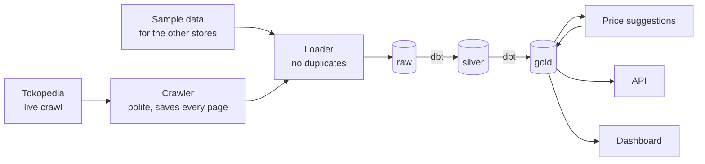
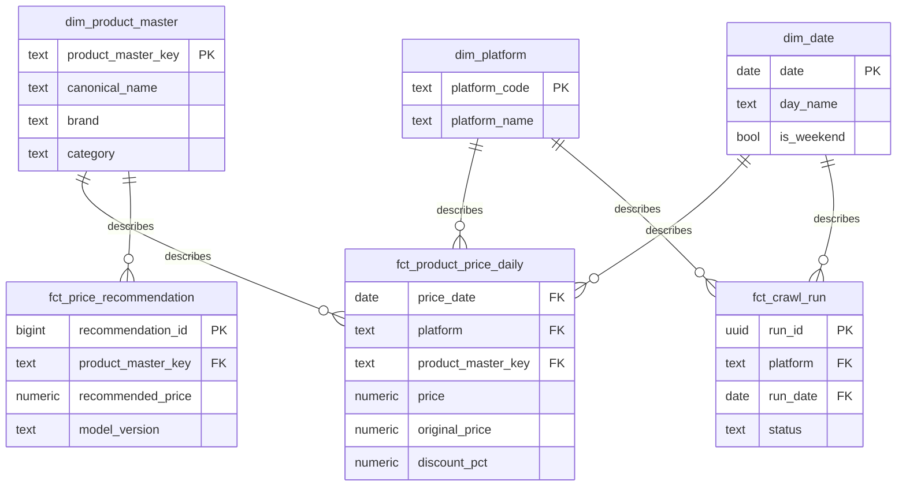

# pricewatch

A small system that collects Unilever product prices from online stores, cleans them, compares
them across stores, suggests our own price, and shows the result in a dashboard and an API.

I built it for the XYZ take-home test. One command starts everything: `docker compose up`.

## 1. How to run it

You only need Docker Desktop.

```bash
cp .env.example .env          # on PowerShell: Copy-Item .env.example .env
docker compose up -d --build  # first build takes a few minutes
docker compose ps -a          # the one-shot steps should say "Exited (0)"
```

| What | Where | Login |
|---|---|---|
| Dashboard (Superset) | http://localhost:8088 | `admin` / `Pricewatch-demo-1` |
| API and its docs | http://localhost:8000/docs | `analyst` / `analyst123` or `admin` / `admin123` |
| Data docs and lineage graph (dbt) | http://localhost:8080 | none |
| Dagster (optional bonus) | http://localhost:3000, after `make orchestrator` | none |
| Database | `localhost:5433`, database `pricewatch` | `pricewatch` / `pricewatch_dev` |

What `docker compose up` does, in order:

1. Starts the database.
2. Loads the sample data and any pages saved from earlier crawls, then tries one live crawl of
   Tokopedia (skipped if a live crawl ran in the last 10 hours).
3. Runs dbt to build the clean tables and run the tests.
4. Calculates the price suggestions.
5. Starts the API, the dashboard (with the dashboard already imported) and the dbt docs.

To never touch Tokopedia, set `SKIP_LIVE_CRAWL=true` in `.env`. Run `make help` to see single
steps, for example `make crawl`, `make test` or `make reset up` (start again from zero).

## 2. How it fits together



Think of three shelves. **raw** keeps exactly what the website showed. **silver** is the cleaned
version. **gold** is the tidy version that people, the API and the dashboard read. The crawler
only writes to raw. The API and the dashboard connect with accounts that can read gold only.

## 3. Collecting the data

- **Tokopedia** is crawled live: one shop page, a few seconds between requests, and I check its
  `robots.txt` before every request.
- **Blibli and Klik Indomaret** blocked automated access, so I used **made-up sample data** for
  them. Sample rows are always labelled `sample`. Every attempt is written down in
  [docs/crawl_attempts.md](docs/crawl_attempts.md).
- Every page is saved as received before anything is read from it. If my parser is wrong, I fix
  it and re-read the saved pages (`make load-landing`) instead of crawling again.
- If the site changes, the crawler tells me instead of failing silently:
  field names live in `config/selectors.yaml`; if the main data is missing it falls back to
  reading the page layout; every record is checked, and bad ones are kept with the reason; each
  run ends as `success`, `degraded`, `failed` or `blocked`.
- Tokopedia sometimes shows a bot-check page. When that happens the crawler stops, marks the run
  `blocked`, and does not try to get around it. The rest of the system keeps working on the data
  it already has.

## 4. The data model

Gold follows a star layout: one table of prices in the middle, and small tables around it that
describe the product, the store and the date.



What one row means in each table (the "grain"):

| Table | One row is... |
|---|---|
| `dim_product_master` | one product, no matter which store sells it |
| `dim_platform` | one store |
| `dim_date` | one calendar day |
| `fct_product_price_daily` | **one listing on one day**: the last price I saw that day |
| `fct_price_recommendation` | one suggested price for one product in one calculation run |
| `fct_crawl_run` | one crawl attempt |

Stores and dates are joined by their real values (`tokopedia`, `2026-10-19`). The only made-up key
is `product_master_key`, because the same product has a different name in every store.

For people who do not want to join tables, gold also has four readable tables with plain column
names: `report_daily_prices`, `report_price_comparison`, `report_price_recommendations` and
`report_pipeline_health`. The dashboard uses only these.

How I handle the hard parts:

- **Same product in different stores:** products are matched by brand, size, pack and variant
  words, plus a small list I checked by hand.
- **Running the crawl twice:** the database refuses a row it already has, so nothing is doubled.
- **Late data:** the daily price table is rebuilt only for the days that received new rows, and
  gives the same result as a full rebuild.
- **Product renamed:** a history table (dbt snapshot) keeps the old and the new name.
- **Quality:** dbt tests check for missing values, duplicates, broken links and impossible prices.
  The proof for each point is in [docs/proof.md](docs/proof.md).
- **Check it yourself:** `make proof` runs two small scripts from `scripts/proof/`. One shows that
  the quick daily update gives exactly the same result as rebuilding everything. The other shows
  that data arriving late still reaches gold, and that a renamed product keeps its old name in
  the history. They use a throw-away database, so your real data is not touched.

## 5. Analysis, dashboard, price suggestions and API

- **Analysis:** four business questions are answered in SQL (`dbt/analyses/`). Results are in
  [docs/analysis_results.md](docs/analysis_results.md) and a one-page summary for non-technical
  readers is in [docs/business_summary.md](docs/business_summary.md). The comparisons between
  stores use sample data, so they show that the method works, not what the real market does.
- **Dashboard:** one Superset dashboard, "Retail Pricing Intelligence". It shows when the last good
  crawl was, a recommended price next to the cheapest competitor, prices per store, the average discount
  for every day and by day of the week, and the status of the latest crawls. It is saved in `dashboards/superset/` and
  imported automatically when you run `docker compose up`. After you change it in Superset, run
  `make dashboard-export` to save it again.
- **Price suggestion:** for each product, take the median competitor price and go 3% below it, but
  never below a floor (an assumed cost plus a 10% margin), rounded to Rp100. It is a simple rule,
  not a real model. Each suggestion stores the model version and the time it was calculated.
- **API:** `/products`, `/prices` and `/recommendations` with filters and pages, and `/health`.
  Log in at `/auth/token`. An `analyst` can read; only an `admin` can start a new calculation with
  `POST /recommendations/runs`. The API reads gold only.

## 6. Orchestration

`docker compose up` already runs the steps in the right order. As a bonus I also modelled the same
chain in **Dagster** (`make orchestrator`). It is optional and does nothing by itself: you press
"Materialize" in its screen or run `make orchestrator-run`. Its daily schedule is switched off by
default, so a normal `up` never crawls twice.

## 7. How this would look on a real data lake

| Here | On a lake (for example on AWS) |
|---|---|
| Saved pages in `data/landing/` | Files in object storage, split by store and date |
| `raw` tables | Iceberg or Delta tables; "insert unless it exists" becomes a `MERGE` |
| dbt on Postgres | dbt on Athena, Trino or Spark |
| Compose or Dagster | Dagster Cloud or Airflow |
| Database accounts that read gold only | Lake Formation permissions |

More in [docs/cloud_note.md](docs/cloud_note.md).

## 8. Choices I made, and what they cost

| Choice | Why | Downside |
|---|---|---|
| Read the data the page already carries as JSON, and the page layout only as a backup | JSON has field names; the layout only has anonymous boxes | JSON can change too, which is why bad runs are flagged |
| Product id = last part of the product URL | 105 of the 346 products in my first crawl have no number in the URL | If a store renames the URL, it looks like a new product |
| Keep prices as text in raw | Raw should show what the site showed; cleaning happens in silver | Everything downstream must use silver |
| Save the page before reading it | Parser mistakes can be fixed without crawling again | About 7 MB per crawl on disk |
| Block duplicates in the database | Works the same for crawler, re-load and sample data | Needs a hash that ignores noisy fields |
| Real values as keys in gold, one made-up key | Easier to read | Products need a generated key |
| httpx instead of Scrapy or a browser | One site, data already in the page, easy to test | Scrapy would suit many sites |
| Superset instead of Metabase | Free, and dashboards can be saved as files | Bigger image |

## 9. What is missing and what I would do with more time

- Real data comes from **one store on two days** (19 and 26 October 2026). Everything that compares
  stores uses sample data. With more time I would find an allowed data source for Blibli and Klik
  Indomaret.
- Tokopedia's terms restrict automated access. The crawl is small and documented, but a real
  system would need permission.
- Prices depend on the delivery address. The crawler uses the site's default.
- The three numbers at the top of the dashboard use the last **successful** crawl. If no crawl has
  succeeded yet (for example when the site blocks the first try), they show no data.
- Product matching is rule-based. With more time I would add fuzzy matching and a review step.
- The price suggestion is a simple rule with an assumed cost, not a real model.
- After new data arrives, one dbt test warns that the previous suggestions point to products that
  were re-matched. This is expected until the price suggestion step runs again.
- There is no automatic test pipeline on GitHub yet.

## 10. Use of AI

I used an AI assistant (Claude) to write most of the code and the documents, following my design
decisions. Everything the AI did is listed in [docs/ai_usage.md](docs/ai_usage.md): what it wrote,
what I decided myself, and how I checked the result.
